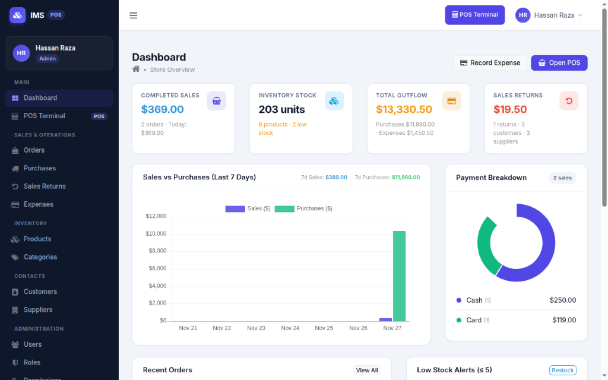
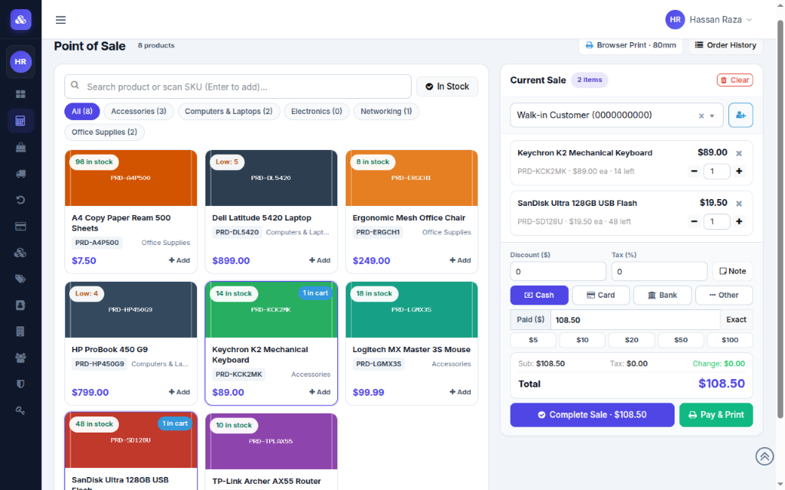
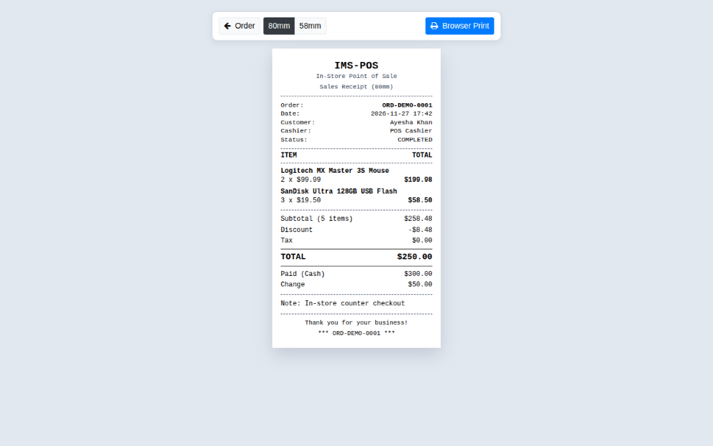
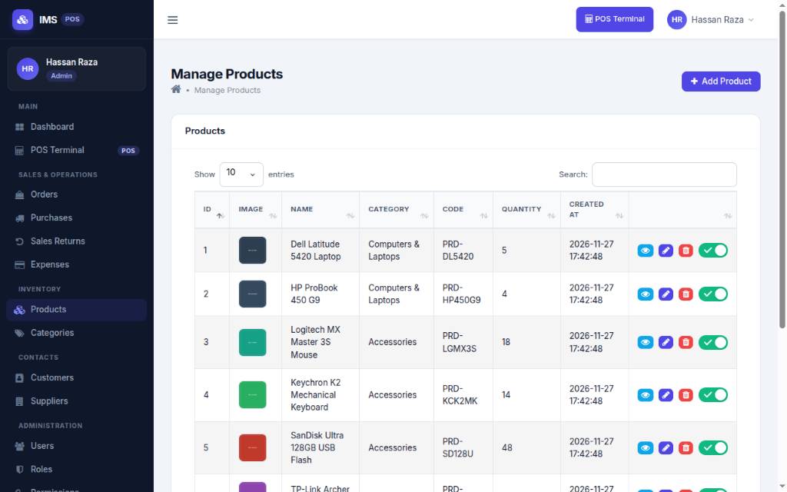
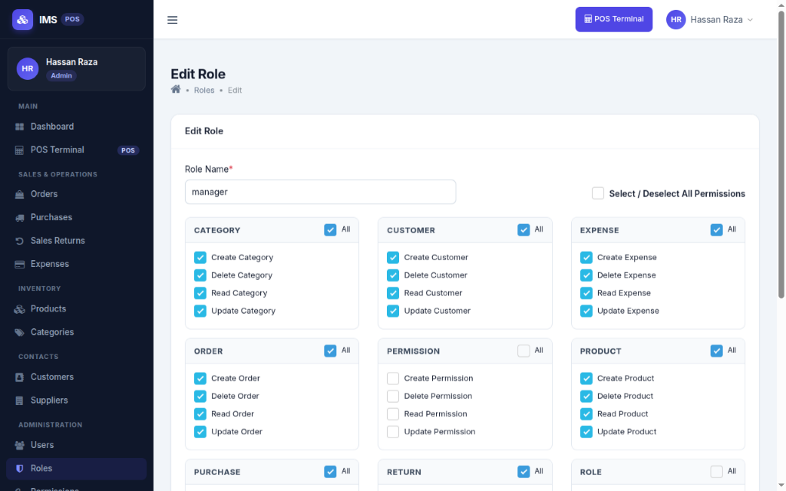

# Laravel Inventory Management with POS (IMS-POS)

[](https://github.com/hassanrazadev/LaravelInventoryWithPOS/actions/workflows/ci.yml)
[](https://www.php.net/)
[](https://laravel.com/)
[](https://laravel.com/docs/pint)
[](LICENSE)

An open-source Inventory Management System and Point of Sale (POS) web application built on **Laravel 13**, **Spatie Laravel Permission**, **MySQL / SQLite**, a clean modern UI with flat single-click navigation, `80mm`/`58mm` receipt printing, and optional LAN ESC/POS thermal printer integration.

---

## Screenshots

### Real-Time Analytics Dashboard & Flat Single-Click Sidebar


### Modern POS Terminal & Sticky Checkout Rail


### Standalone 80mm / 58mm Thermal Receipt Preview


### Product Inventory Management & Stock Indicators


### Role-Based Access Control (RBAC) Permission Matrix


---

## Features

- **Modern Application Shell & Analytics Dashboard**
  - Flat single-click grouped sidebar (`MAIN`, `SALES & OPERATIONS`, `INVENTORY`, `CONTACTS`, `ADMINISTRATION`) with pinned **POS Terminal** access and collapsible mini-rail on POS screens.
  - Real-time KPIs for completed sales, inventory stock units, low-stock alerts (`<= 5` units with direct Restock links), purchases, expenses, and sales returns.
  - Interactive 7-day Sales vs. Purchases bar chart and Payment Breakdown doughnut chart (Chart.js).
- **Point of Sale (POS) Terminal**
  - Responsive product catalog grid with category filter pills & item counts, **In Stock** toggle, live name/SKU search, and Enter-to-add barcode/SKU scanning.
  - Sticky `430px` checkout rail with compact 2-row card cart items, quantity steppers, discount (`$`), percentage tax (`%`), collapsible counter note, payment method pills (`Cash`, `Card`, `Bank`, `Other`), quick `$5 / $10 / $20 / $50 / $100` tender chips, live change-due calculation, and paired **Complete Sale** + **Pay & Print** actions.
  - Inline Quick-Add Customer modal without losing the active cart.
  - Atomic database checkout with row-level locking (`lockForUpdate`), standalone printable `80mm`/`58mm` receipts (`/orders/{id}/receipt`), order cancellation with stock restoration, and soft-delete safeguards.
- **Receipt Printing & Optional ESC/POS Hardware Support**
  - Built-in **Browser Print** (`80mm` / `58mm` `@page` thermal CSS) enabled by default with zero external hardware or software dependencies.
  - **Optional** direct **Raw ESC/POS TCP Socket** (typically port `9100` for LAN receipt printers), **HTTP POST Bridge**, and opt-in **ESC/POS Cash Drawer Pin 2 kick** (`ESC p 0 25 250`) configurable via `.env` or POS **Receipt Printer Settings**.
- **Inventory, Purchasing, Contacts & Operations**
  - **Categories** and **Products** CRUD with parent/child hierarchy, unique SKUs, stock tracking, and Cropper.js image uploads.
  - **Purchases** CRUD linked to **Suppliers** with transactional stock updates and delete protection when purchases exist.
  - **Customers**, **Expenses** (category filters & soft-delete toggles), and **Sales Returns** (remaining-quantity validation & optional inventory restocking).
- **Authentication & Role-Based Access Control (RBAC)**
  - Remember Me login, `POST /user/logout`, forgot/reset password flow, and User Profile management (`current_password` validation).
  - Full **Users**, **Roles** (grouped permission matrix), and **Permissions** CRUD backed by Spatie Laravel Permission (`44` permissions across `11` modules) with self-deletion and last-admin protections.

---

## Receipt Printing & Optional ESC/POS Hardware Configuration

By default, IMS-POS uses **Browser Print (`browser`)**, so production deployments work out of the box without any printer daemon or LAN hardware. Direct ESC/POS socket/HTTP printing (`App\Services\ThermalReceiptService`, configured in [config/pos.php](config/pos.php)) is strictly **optional** for counters equipped with LAN thermal printers:

| Environment Variable | Default | Description |
| --- | --- | --- |
| `POS_STORE_NAME` | `"${APP_NAME}"` | Store title printed at the top of receipts |
| `POS_PRINTER_DRIVER` | `browser` | `browser` (default, no hardware required), `tcp` (optional LAN ESC/POS), or `http` (optional bridge) |
| `POS_PRINTER_HOST` | `127.0.0.1` | Optional LAN thermal printer IP / localhost when `tcp` or `http` is enabled |
| `POS_PRINTER_PORT` | `9100` | Optional ESC/POS TCP socket port (standard `9100`) |
| `POS_PRINTER_WIDTH` | `80` | Thermal paper roll width in mm: `80` (`48` columns) or `58` (`32` columns) |
| `POS_OPEN_CASH_DRAWER` | `false` | Optional ESC/POS Pin 2 solenoid pulse (`1B 70 00 19 FA`) on Cash sales when using `tcp`/`http` |

> **Local Development Testing Note:** If you test raw ESC/POS payloads locally during development using an external virtual printer emulator or simulator, keep it strictly in your local dev/test environment — it is a separate testing tool, is **not bundled with IMS-POS**, and must **not** be deployed to production. Keep `POS_PRINTER_DRIVER=browser` for standard production builds unless connecting to a real LAN thermal printer.

> **SSRF Security:** When optional `tcp` or `http` printing is enabled, `ThermalReceiptService::isAllowedPrinterHost()` permits only loopback hosts (`127.0.0.1`, `localhost`, `::1`), the configured `POS_PRINTER_HOST`, and private RFC1918 LAN IPv4 subnets (`10.0.0.0/8`, `172.16.0.0/12`, `192.168.0.0/16`). Public IPs, link-local metadata ranges (`169.254.0.0/16`), and arbitrary domains are rejected with HTTP `422`.

---

## Architecture & Modules

| Module | Controllers / Services | Key Routes |
| --- | --- | --- |
| **Dashboard & Profile** | `HomeController`, `ProfileController` | `/`, `/profile` |
| **POS, Orders & Receipts** | `OrderController`, `ThermalReceiptService` | `/orders`, `/orders/create`, `/orders/{order}/receipt`, `/orders/{order}/print-thermal`, `/orders/pos/printer/test` |
| **Catalog & Inventory** | `CategoryController`, `ProductController` | `/categories`, `/products` |
| **Purchasing & Contacts** | `PurchaseController`, `SupplierController`, `CustomerController` | `/purchases`, `/suppliers`, `/customers` |
| **Operations & Adjustments** | `ExpenseController`, `SaleReturnController` | `/expenses`, `/returns` |
| **Auth & RBAC** | `AuthController`, `UserController`, `RoleController`, `PermissionController` | `/user/login`, `/users`, `/roles`, `/permissions` |

---

## Tech Stack

- **Backend:** PHP 8.3+, Laravel 13 (slim directory structure), Spatie Laravel Permission 8
- **Database:** MySQL 8+ (local/production) & SQLite (automated testing)
- **Frontend:** Blade templates, Bootstrap 4, jQuery, DataTables, Select2, Cropper.js, Chart.js 2.7, Vite 7
- **Quality & Testing:** PHPUnit 12 (`52` automated tests), Laravel Pint (`laravel` preset), GitHub Actions CI (`PHP 8.3` & `8.4`)

---

## Installation

### Prerequisites

- PHP `>= 8.3` with extensions: `gd`, `mbstring`, `pdo_mysql` (or `pdo_sqlite`), `xml`, `zip`
- [Composer](https://getcomposer.org/) `>= 2.x`
- MySQL `8.0+` (or SQLite for quick local evaluation)
- Node.js & npm *(optional, only needed if customizing Vite assets)*

### Setup Steps

1. **Clone the repository**
   ```bash
   git clone https://github.com/hassanrazadev/LaravelInventoryWithPOS.git
   cd LaravelInventoryWithPOS
   ```

2. **Install PHP dependencies**
   ```bash
   composer install
   ```

3. **Configure your environment**
   ```bash
   cp .env.example .env
   php artisan key:generate
   ```
   Update `DB_*` credentials in `.env` for your local MySQL database (or switch `DB_CONNECTION=sqlite`). Leave `POS_PRINTER_DRIVER=browser` for standard browser receipt printing, or optionally configure `tcp`/`http` if connecting a physical LAN ESC/POS printer.

4. **Create storage symlink & migrate + seed database**
   ```bash
   php artisan storage:link
   php artisan migrate --seed
   ```
   > **Note:** `DatabaseSeeder` automatically seeds `PermissionsTableSeeder`, `RolesTableSeeder`, `CreateAdminSeeder`, and `DemoDataSeeder` (categories, products with generated placeholder PNGs, suppliers, customers, purchases, demo orders, expenses, and a sample sales return) in non-production environments.

5. **Start the development server**
   ```bash
   php artisan serve
   ```
   Open [http://127.0.0.1:8000](http://127.0.0.1:8000) in your browser.

---

## Demo Accounts

When seeded locally or with `DemoDataSeeder`:

| Role | Email | Password | Access Scope |
| --- | --- | --- | --- |
| **Admin** | `admin@test.com` | `123456` | Full access (all modules, users, roles & permissions) |
| **Manager** | `manager@test.com` | `123456` | Categories, products, purchases, orders, suppliers, customers, expenses & returns |
| **Cashier** | `cashier@test.com` | `123456` | Read categories/products, POS checkout/orders, add/view customers |

> **Security Notice:** Change all demo credentials or remove `DemoDataSeeder` users immediately before deploying to any public or production server.

---

## Testing & Code Style

Run the automated test suite (uses an in-memory SQLite database via `phpunit.xml`):

```bash
composer test
# or
php artisan test
```

Check or format code style using Laravel Pint:

```bash
composer lint     # Dry-run check (enforced in CI)
composer format   # Auto-fix formatting issues
```

---

## Community, Documentation & License

- [Contributing Guide](CONTRIBUTING.md)
- [Code of Conduct](CODE_OF_CONDUCT.md)
- [Security Policy](SECURITY.md)
- [Changelog](CHANGELOG.md)
- [MIT License](LICENSE)

---

## Author

- **Hassan Raza** — [hassanraza.net](https://hassanraza.net) · `info@hassanraza.net`
